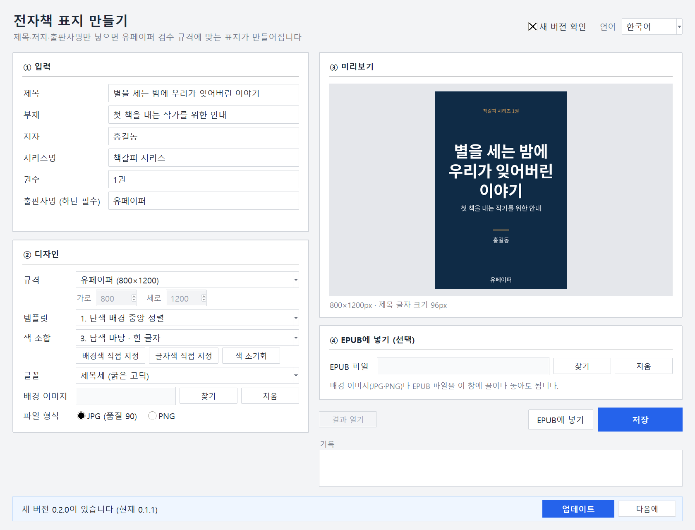

# 책갈피 툴 – 전자책 표지 만들기

[English](README.en.md) · [中文](README.zh-CN.md) · [日本語](README.ja.md)

제목·저자·출판사명만 입력하면 유페이퍼 검수 규격(가로 600~1000px, 하단 출판사명)에 맞는 전자책 표지 이미지를 만들어 줍니다. 디자인 툴이 아니라 규격 통과용 표지 생성기입니다. 서버 없음, 설치 없음, 원본 EPUB과 배경 이미지 무수정(새 버전 확인만 예외, 끌 수 있음).


## 다운로드

- **실행 파일**: [Releases](https://github.com/microhan1/ebook-cover-maker/releases)에서 `ebook-cover-maker.exe`를 받아 더블클릭. 설치 없이 바로 실행됩니다. 서명이 없어 SmartScreen 경고가 뜨면 "추가 정보 → 실행"을 누르세요.
- **소스 실행**:

```bash
pip install -r requirements.txt
python main.py
```

## 사용법

1. 제목·저자·출판사명을 입력합니다. 출판사명이 비어 있으면 저장 버튼이 잠기고 이유가 표시됩니다.
2. 규격·템플릿·색 조합을 고릅니다. 미리보기가 바로 바뀝니다.
3. **저장**을 누르면 `cover.jpg`가 만들어집니다. 이미 있으면 `cover(2).jpg`. **EPUB에 넣기**를 누르면 `<원본명>_cover.epub`이 새로 생깁니다.

명령줄로도 쓸 수 있습니다.

```bash
python main.py --title "제목" --author "저자" --publisher "출판사" --preset upaper --template 1 --color 3 -o cover.jpg
python main.py --title "제목" --author "저자" --publisher "출판사" --bg photo.jpg --template 4 --epub book.epub -y
```

`python main.py --help`가 OS 언어(한국어 · English · 中文 · 日本語)로 옵션을 보여줍니다.

## 유페이퍼 표지 규격 요약

| 항목 | 규격 | 이 도구 |
|---|---|---|
| 크기 | 가로 600~1000px (권장 700×1000) | 기본 프리셋 800×1200 (2:3) |
| 출판사명 | 표지 하단에 표기 | 항상 하단 10% 영역 안에 그리고 저장 시 확인 |
| 파일 형식 | JPG 권장, RGB | JPG 품질 90 (PNG 선택 가능), RGB |
| EPUB 안 위치 | 첫 장, 표지 하나만 | cover 메타 등록 + spine 첫 장, 기존 SVG 래퍼는 img로 교체 |

## 하지 않는 것

- 자유 배치 편집(드래그로 글자 옮기기, 레이어)은 없습니다. 캔바가 아닙니다.
- 일러스트·사진 생성은 하지 않습니다.
- 종이책 표지(책등·뒷면·재단선)는 만들지 않습니다.
- 글꼴 추가 설치는 지원하지 않습니다. 내장 글꼴 3종(본문체·제목체·명조체)만 씁니다.
- 새 버전을 자동으로 내려받거나 바꾸지 않습니다.

## 새 버전 확인

실행할 때 새 버전이 있는지 확인하려고 도구 이름과 버전만 책갈피 서버(chaekgalpi.co.kr)에 보냅니다. 파일은 보내지 않고, 하루 한 번만 확인하며, 설정에서 끌 수 있습니다. 창 오른쪽 위의 「새 버전 확인」 체크를 끄면 됩니다. 새 버전이 있으면 창 아래에 한 줄로 알려 주고, [업데이트]를 누르면 책갈피 툴 페이지가 브라우저로 열립니다.



## 글꼴

내장 글꼴은 Noto Sans CJK·Noto Serif CJK(SIL Open Font License 1.1)입니다. 원문은 `fonts/LICENSE-Sans.txt`, `fonts/LICENSE-Serif.txt`에 있습니다.

## 시리즈

- 책갈피 툴: [스캔 PDF 보정](https://github.com/microhan1/scan-pdf-cleanup) · [두쪽 나누기](https://github.com/microhan1/scan-pdf-split) · [여백 자르기](https://github.com/microhan1/TrimPDF) · 전자책 파일명 정리(곧 공개)
- 설치 없이 브라우저에서 쓰는 웹판: [펼침면 나누기](https://microhan1.github.io/spread-split/)
- [책갈피 라이브러리](https://chaekgalpi.co.kr/tools/ebookcover?utm_source=github&utm_medium=referral&utm_campaign=tool_cta&utm_content=ebookcover) — 읽은 책과 독서록을 기록하는 웹 서비스.

## 라이선스

MIT. [LICENSE](LICENSE) 참조. 글꼴은 OFL(`fonts/`).

서드파티 라이선스는 [THIRD_PARTY_LICENSES.txt](THIRD_PARTY_LICENSES.txt)에 있습니다.
